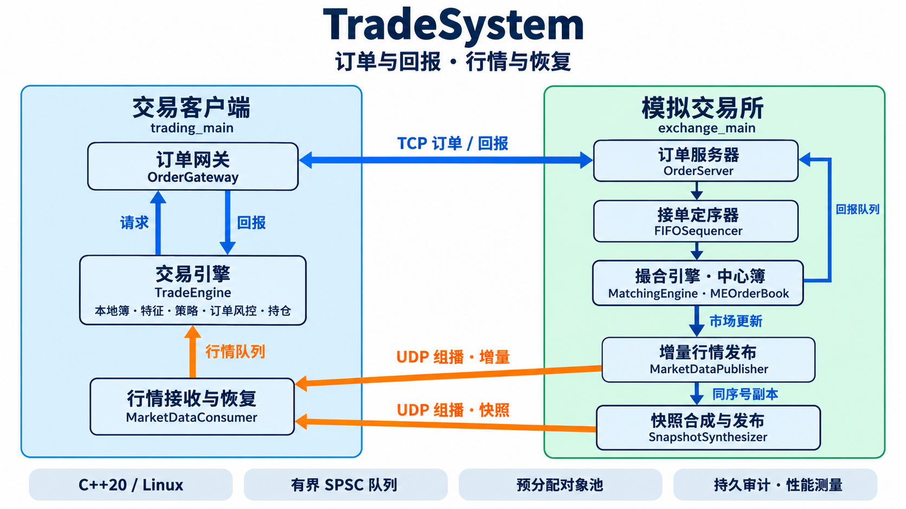
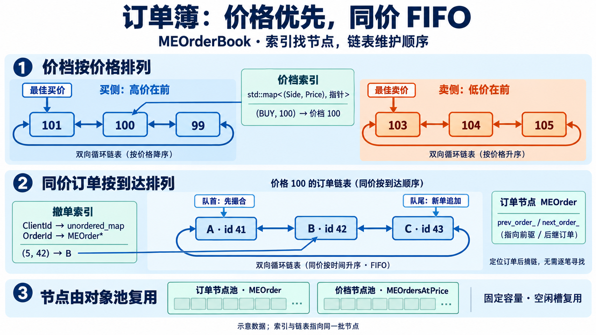
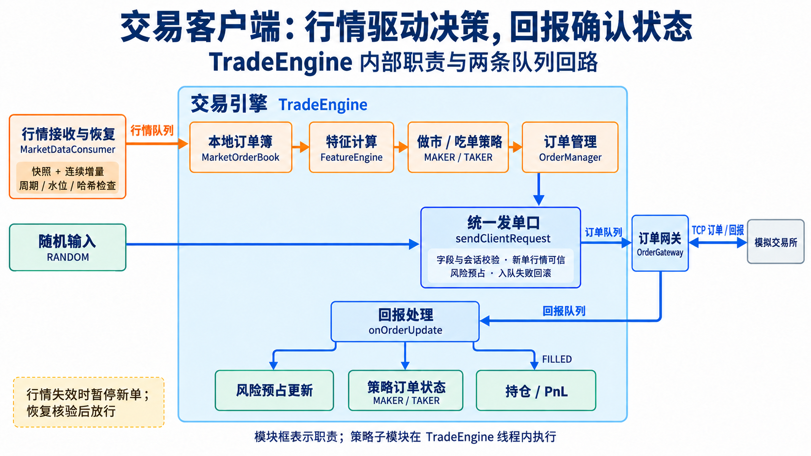

# TradeSystem｜C++20 低延迟交易系统

TradeSystem 是一个面向 Linux 的 C++20 模拟交易系统，由模拟交易所和交易客户端两个进程组成。交易所负责接单、定序与撮合，客户端负责行情恢复、策略决策、订单管理与风险控制。订单与回报走 TCP，增量行情与快照走 UDP 组播，组件之间通过有界 SPSC 队列交接。

本仓库围绕消息完整性、订单状态、可控停机和可复现性能测量持续改造。每项工作都保存问题复现、修复代码、验证方法与实测结果，方便检查实现是否正确、性能变化来自哪里。

## 系统总览：订单与回报，行情与恢复



蓝色表示订单与私有回报，橙色表示公开行情。两个进程通过 TCP 和 UDP 组播通信，进程内的跨线程消息由有界 SPSC 队列交接。图中的框表示模块职责；交易引擎内的特征、策略和订单管理在所属线程中执行。

**订单闭环。** 策略或随机输入产生请求，统一发单口完成校验与风险预占，订单网关经 TCP 发送到交易所。订单服务器解析和校验请求，FIFO 定序器交给撮合引擎；受理、撤单和成交回报沿 TCP 返回客户端。`ACCEPTED` 表示受理，`FILLED` 表示成交；持仓按成交回报更新。

**行情闭环。** 撮合产生市场更新，发布器添加增量序号，并把同序号副本交给快照合成器。客户端正常消费增量，发现缺口时用完整快照衔接连续增量；接收端校验完整快照和连续增量，整批发布；本地簿应用到恢复结束标记、代次仍有效后放行新单，不再重复计算全簿哈希。

### 三份状态各自负责什么

| 状态 | 负责什么 | 更新来源 |
| --- | --- | --- |
| 交易所中心簿 `MEOrderBook` | 保存活动订单，决定模拟撮合结果 | 新单、撤单等合法请求 |
| 快照合成器的活动订单集合 | 保存某个增量水位上的副本，发布恢复快照 | 撮合产生的增量更新 |
| 客户端本地簿 `MarketOrderBook` | 维护策略看到的盘口与 BBO | 增量行情或完整恢复批次 |

## 订单簿：索引找节点，链表维护顺序



撮合引擎为每个品种维护一份中心簿。其结构分为四层：

1. **完整价档索引。** 主实现用 `std::map<PriceKey, MEOrdersAtPrice*>`，键为 `(Side, Price)`。买卖方向和完整价格共同标识价档，价格 100 与 356 可以分别定位。
2. **按价格排列的价档链。** 买侧从高价到低价，卖侧从低价到高价；双向循环链表配合最佳买价、最佳卖价指针，使撮合从当前最优档开始。
3. **同价 FIFO 与撤单索引。** 每个价档内的订单也是双向循环链表，新单追加到尾部，撮合从队首消费。订单节点自带前驱、后继指针，索引与链表指向同一份订单。每个客户端另有 `OrderId → MEOrder*` 的稀疏映射，撤单先定位节点，再把它从链中摘除。
4. **固定容量的对象池。** 订单节点和价档节点分别由 `MemPool` 管理；空闲槽栈提供可复用位置，分配时构造对象，归还时析构对象。

图中的示意队列为 A → B → C。撤掉 B 时，索引找到 B，连接 A 与 C，再回收 B 的槽；随后加入 D，队列成为 A → C → D，原有订单的先后顺序保持。

**这套设计的代价。** 主实现的价档索引查找为 O(log P)，其中 P 是活动价档数；新最优、新最差档利用价格环端点直接连接，中间档仍需沿链找位置。索引容器也可能动态分配内存。对象池减少订单和价档节点的分配，整体耗时仍由负载与测量决定。仓库保留以完整价格键建立 `unordered_map` 索引的对照实现，最新价档对照见 [07 改造与复测](record/07_book_recovery.md)。

实现入口：[节点与索引类型](exchange/matcher/me_order.h)、[中心簿](exchange/matcher/me_order_book.h)、[撮合处理](exchange/matcher/me_order_book.cpp)、[对象池](common/mem_pool.h)。

## 交易客户端：行情驱动决策，回报确认状态



`MAKER` 和 `TAKER` 实现统一的 `Strategy` 基类，根据本地簿及特征计算订单目标，由 `OrderManager` 管理策略订单。客户端 JSON 在启动时选择策略，工厂只创建一次对象，事件处理直接通过基类接口分派。`RANDOM` 直接调用统一发单口；最终出口都执行字段、会话与风险检查，新单还要求行情可信。请求无法进入队列时，已预占的风险额度回滚。

回报进入 `TradeEngine::onOrderUpdate()` 后，先做身份、重复回报和风险状态检查；`FILLED` 更新持仓与盈亏，策略回调更新订单状态。行情缺口会使本地状态失效，恢复批次一次入队；本地簿应用到有效代次的结束标记后恢复新单准入，交易引擎不重复校验快照哈希。正常增量连续时忽略周期快照，恢复期间缓存并续接快照水位之后的增量。

实现入口：[交易引擎](trading/strategy/trade_engine.cpp)、[订单管理](trading/strategy/order_manager.h)、[风险控制](trading/strategy/risk_manager.h)、[行情恢复](trading/market_data/market_data_consumer.cpp)。

## 其他值得关注的设计

| 设计 | 解决的问题 | 实现与边界 |
| --- | --- | --- |
| 有界 SPSC 消息队列 | 跨线程交接与容量约束 | acquire/release 交接槽位所有权，满队列返回失败；适用于单生产者、单消费者。见 [LFQueue](common/lf_queue.h)。 |
| 保留 TCP 发送进度 | 短写或暂时不可写时保存尾部 | 按实际发送字节推进，完整帧进入缓冲后才出队。见 [TCPSocket](common/tcp_socket.cpp)。 |
| 完整批次的行情恢复 | 避免策略使用部分重建的盘口 | 接收端检查周期、水位、序号与快照哈希；本地应用到有效代次后恢复新单。见 [恢复验收](record/01_reliability.md)、[恢复简化](record/07_book_recovery.md)。 |
| 线程所有权与排空 | 让停止和资源释放有顺序 | 停新输入、按依赖排空、join 工作线程。见 [线程工具](common/thread_utils.h)及 [可靠性记录](record/01_reliability.md)。 |
| 关键审计与诊断日志分开 | 使交易事件可对账，性能观测有清晰范围 | 关键审计逐条持久化，工具支持只读对账；自动崩溃重放尚未实现。见 [可靠性记录](record/01_reliability.md)。 |
| 逐请求的外部测量 | 把生成器迟到、请求往返和窗口吞吐分开 | 固定输入、多轮测量、保留慢轮与未完成请求。见 [测量口径](record/02_measurement.md)。 |

## 技术栈 / Tech Stack

| 领域 | 本项目中的实现 |
| --- | --- |
| 语言与构建 | C++20、GCC、CMake、Ninja；Linux 与 `pthread` |
| 启动配置与策略 | Glaze v2.9.5、交易所/客户端独立 JSON、`Strategy` 基类和启动工厂 |
| 网络通信 | TCP 订单与回报、`epoll` 事件循环、UDP 组播增量与快照 |
| 并发交接 | 组件工作线程、有界 SPSC 队列、C++20 常量容量约束、原子读写水位与 CPU 亲和性 |
| 订单簿与内存 | 完整价格键、稀疏订单索引、双向循环链表、固定容量对象池 |
| 交易逻辑 | 请求定序、价格优先与同价 FIFO、订单状态、风险预占、持仓与盈亏 |
| 验证与测量 | 参考模型、故障注入、ASan/UBSan、TSan、固定输入与逐请求延迟样本 |

## 已完成的改造

- [组播接口选择](record/01_reliability.md)：明确收发接口，验证增量与快照组播路径。
- [可靠性改造](record/01_reliability.md)：有界队列、TCP 背压与部分发送、完整价格键、协议与会话校验、在途风控、行情恢复、线程排空及持久审计。
- [可复现测量](record/02_measurement.md)：修正基准计数与计时口径，核对业务输出，保存固定输入和逐条请求样本，分别运行开环、闭环与容量实验。
- [策略、启动配置与源码精简](record/07_book_recovery.md)：统一策略接口，两份 JSON 配置网络与策略参数；补足行情通道边界，精简客户端及对照簿插入逻辑，保留旧/新性能结果。
- [队列与消费热路径](record/07_book_recovery.md)：常量容量在编译期检查，游标使用两倍容量掩码；减少正常路径诊断文本和单条定序的冗余工作，逐项对照后保留收益明确的方案。

这是模拟环境。持久审计支持事后对账；已有审计文件会阻止直接复用该运行目录，进程崩溃后的自动重放和继续交易尚未实现。

## 目录 / Repository Layout

```text
common/       线程、网络、队列、内存池、日志、启动配置和性能工具
config/       交易所与客户端 JSON 示例
third_party/  固定版本的 Glaze 头文件和许可
exchange/     订单服务器、撮合引擎、行情发布与快照合成
trading/      行情接收、订单网关、交易引擎和示例策略
benchmarks/   微基准程序
notebooks/    按实验目录分析诊断日志、组件 CSV 和逐请求数据
scripts/      构建与示例运行脚本
assets/       系统总览、订单簿与客户端设计图
record/       修复与性能报告，以及对应的定向测试和基准
tests/        正式回归与测量支持代码
```

## 构建与运行 / Build & Run

在 Linux 上准备支持 C++20 的 GCC、CMake 3.16 或更新版本、Ninja 和 Python 3。本次在 Ubuntu 26.04、GCC 15 下编译和验证。Glaze v2.9.5 头文件已随仓库保存，构建不需要下载依赖。

`config/exchange.json` 指定交易所 TCP 监听地址、两路 UDP 组播端点和网卡；`config/client.json` 指定客户端订阅端点、TCP 远端、客户 ID、策略和风控参数。示例沿用回环网卡 `lo`，快照为 `233.252.14.1:20000`，增量为 `233.252.14.3:20001`。跨机器运行时修改相应 JSON，并确保两端地址、端口一致；各自填写本机网卡名称。

CMake 将示例复制到构建目录的 `config/`。默认读取可执行文件旁的配置目录；`--config` 可指定其他文件。修改源目录的示例后重新运行 CMake 才会更新构建目录副本，也可以直接指定源文件。

```bash
cmake -S . -B build/release -G Ninja -DCMAKE_BUILD_TYPE=Release \
  -DTRADE_PERF_TRACE_EVERY=0
cmake --build build/release -j 2

# 定向核对配置、策略、行情通道和特征
ctest --test-dir build/release \
  -R '^(runtime_config_contract|strategy_behavior|recovery_channel|reliability_features)$' \
  --output-on-failure

# 定向检查队列和本轮消费契约
ctest --test-dir build/release \
  -R '^(queue_capacity_contract|queue_semantics|consumer_hotpath_contract|trade_engine_consumer_contract)$' \
  --output-on-failure

# 只检查配置，不创建审计文件或启动网络线程
build/release/exchange_main --config config/exchange.json --check-config
build/release/trading_main --config config/client.json --check-config

# 终端 1：启动模拟交易所
exchange_binary="$(realpath build/release/exchange_main)"
exchange_config="$(realpath config/exchange.json)"
exchange_run_dir="$(mktemp -d)"
(cd "$exchange_run_dir" && TRADE_SNAPSHOT_MS=200 "$exchange_binary" --config "$exchange_config")

# 终端 2：启动随机订单客户端
trading_binary="$(realpath build/release/trading_main)"
client_config="$(realpath config/client.json)"
client_run_dir="$(mktemp -d)"
(cd "$client_run_dir" && TRADE_RUN_SECONDS=10 TRADE_RANDOM_ORDERS=100 \
  "$trading_binary" --config "$client_config" 5 RANDOM)
```

可直接使用 `exchange_main --config /path/exchange.json` 和 `trading_main --config /path/client.json` 启动。上例的 `5 RANDOM` 覆盖客户 ID 和策略，用于随机订单演示；省略它们则采用客户端 JSON 的客户 ID 和策略。`strategy.type` 支持 `MAKER`、`TAKER`、`RANDOM`；`default_parameters` 用于全部 8 个品种，`tickers` 中的 `ticker_id` 与完整参数覆盖指定品种，空数组 `[]` 表示无覆盖。配置字段拼错、缺少必填项或越界时，程序输出错误并返回 2。

`TRADE_PERF_TRACE_EVERY=0` 关闭诊断计时采样，与第 7 篇的 Release 性能对照一致；订单审计仍保留。需要诊断采样时重新配置为 `1` 或每 N 次采样的正整数，采样结果与关闭采样的成绩分开比较。

原客户端 `CLIENT_ID ALGO [五项品种参数]...` 仍可使用，它覆盖 JSON 中对应值；网络配置始终来自 JSON。`TRADE_RUN_SECONDS`、`TRADE_RANDOM_ORDERS`、`TRADE_RANDOM_DELAY_US` 的环境变量优先于 JSON `runtime`，在启动工作线程前统一校验。TCP 客户端的源地址由系统路由选择，组播通过配置网卡选择收发接口。

脚本入口已同步上述构建目录与 JSON 配置，可使用：

```bash
bash scripts/no_clean_build.sh                        # Release 增量构建
bash scripts/no_clean_build.sh debug                  # Debug 增量构建
TRADE_RANDOM_ORDERS=100 bash scripts/run_exchange_and_clients.sh 5 RANDOM
bash scripts/run_benchmarks.sh                        # 当前组件的 7 轮测量
```

联合脚本只增量构建两个主程序，检查配置并确认本次交易所监听后启动客户端，默认运行 10 秒；每次创建独立运行目录，保留日志与审计，只停止自己启动的 PID。单独客户端默认读取 JSON 的策略和参数；不再使用脚本中的硬编码品种配置。基准脚本复用已有组件程序，不表示整条订单链或旧／新源码对照。自定义配置、目录和期限见 [脚本说明](scripts/README.md)。运行生成的 `*.log`、构建目录和 HTML 分析报告不会提交到 Git。

每次运行使用独立目录保存日志与审计文件。客户端完成初始快照验证后才开始交易；上例将快照间隔设为 200 ms，便于快速演示。结束时使用 `Ctrl+C` 触发排空和停机；历史审计文件应先完成对账，再由操作者归档。

## 性能测量

组件基准和回归支持代码位于 `benchmarks/`、`tests/` 及本轮 `record/07_queue_pool_consumer/`。历史批次驱动和逐请求样本已独立归档，报告按[测量口径](record/02_measurement.md)解释输入、窗口、对账和分位数。

[性能 notebook](notebooks/README.md) 使用 `TRADE_ANALYSIS_DIR` 选择一次实验目录，分别读取组件 CSV、逐请求 CSV 与诊断日志。它保留完整慢样本，不用固定 CPU 主频换算 TSC，也不把无请求 ID 的相邻 TTT 行当作链路延迟；默认关闭诊断采样时会明确提示无记录。

策略多态以可维护性为目标。分派、策略回调、行情接收、价档插入、队列和消费端分别测量；交易所订单往返另做固定输入配对对照，详见[本次记录](record/07_book_recovery.md)。队列整窗均值和消费批次平均耗时的分位数分别标注，不能混作单请求网络延迟。

2026-10-14 的本轮对照中，业务对账通过，网络往返 P50 没有改善；同程序重复运行也有明显波动，具体新增等待尚未定位。完整快慢轮与范围见第 7 篇。

常量容量通过 `QueueCapacity<N>` 标签约束；运行时容量保留构造检查。槽位使用 N−1 掩码，游标使用 2N−1 掩码，容量与满空规则保持不变。对象池本轮标记分离候选虽然省内存，但实测变慢，未采用。同步审计、排队和环境仍影响订单链；[组件与发送](record/05_components_and_response.md)和[环境诊断](record/06_latency_and_environment.md)保留历史测量、慢轮与未采用候选。

## 来源与许可 / Attribution

项目的初始代码来源于 Packt Publishing《[Building Low Latency Applications with C++](https://github.com/PacktPublishing/Building-Low-Latency-Applications-with-CPP)》。本仓库在其基础上进行改造，遵循 [MIT License](LICENSE)，保留原版权声明；后续改动与验证记录见 `record/`。JSON 配置使用 [Glaze v2.9.5](https://github.com/stephenberry/glaze/tree/v2.9.5)，其 [MIT 许可](third_party/glaze/LICENSE)保存在仓库中。
