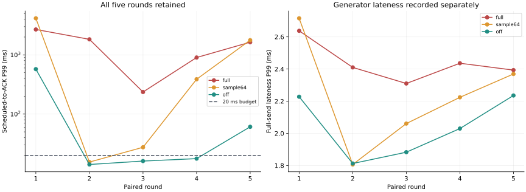
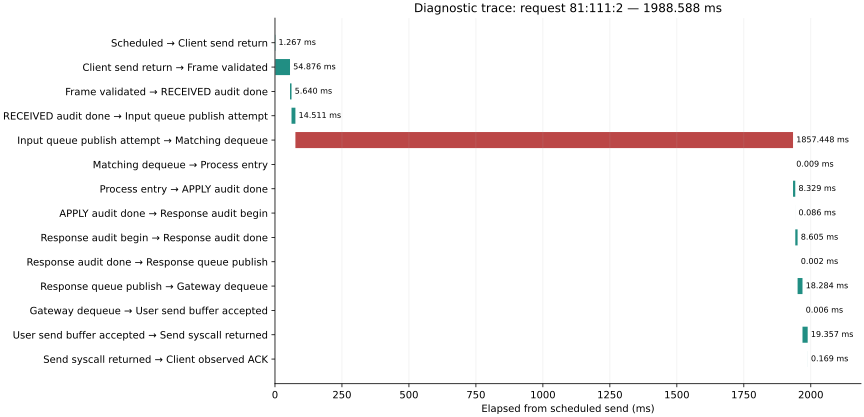

# 03 性能调优：日志开销与尾延迟

测量日期：2026-10-03；文档核对：2026-10-04。基线：`3ac3c20`。

关闭可选性能日志后，五轮配对 P99 降幅中位数为 **96.28%**。全部业务对账通过，但两轮仍超过 20 ms 门槛，尾延迟没有彻底解决。快照公开返回类型的编译问题也已修复并回归。

## 测试发现了什么

改动前一轮 6,000 条请求全部得到回报，P99 却有 796.713 ms；预热加测量产生约 171 MB 网关日志。只看“请求最终完成”会漏掉延迟问题。

`OrderServer::recvFinishedCallback()` 在 FIFO 为空时也执行计时宏，忙轮询持续触发读时钟、格式化和诊断日志入队。关键审计由独立组件完成，减少诊断记录不等于减少审计。

新增快照组件实验还发现：头文件只声明 `auto` 返回类型，外部编译单元看不到定义，无法推导类型。

## 怎样处理

新增 `TRADE_PERF_TRACE_EVERY` 构建配置：1 保留全量，64 每线程、每调用位置抽样，0 关闭。默认仍为 1。

关闭模式的三个宏是空操作，连 Logger 参数和计时调用也不求值；抽样计数为线程局部值。普通业务/错误日志及逐条 fsync 审计保留。抽样日志不能代替全体请求的 P99，正式延迟仍由外部生成器逐条记录。

快照声明和定义均明确改为 `void`。例如：

```cpp
// 修改前
auto publishSnapshot();
// 修改后
void publishSnapshot();
```

这解决跨编译单元调用问题，不改变快照算法。完整宏、CMake 和两个快照方法的前后代码见 [03_source_changes.md](03_source_changes.md)。

## 重新测量的结果

三模式各五轮，轮次顺序交替。每轮预热 30 秒，再按 100 请求/秒测 60 秒，共 6,000 条请求；4 客户端、8 品种、不成交 NEW/成功 CANCEL，日志和审计放 ext4。

| 模式 | P50，ms | P99，ms | 五轮 P99 范围，ms |
|---|---:|---:|---:|
| 全量 | 21.007 | 1,638.357 | 235.897–2,686.475 |
| 1/64 抽样 | 9.368 | 387.280 | 15.459–4,149.268 |
| 关闭 | 9.092 | 17.669 | 14.067–574.016 |

各格是每轮分位数的中位数。逐轮数据见 [paired_runs.json](evidence/paired_runs.json)，汇总见 [paired_summary.json](evidence/paired_summary.json)。



关闭模式五轮配对降幅为 78.63%、99.23%、93.19%、98.04%、96.28%，中位数 96.28%。若先取两组 P99 中位数再算比例，会得到 98.92%；这是另一种统计，不能混称。

关闭模式两轮 P99 为 **574.016 ms、60.925 ms**，仍未过门槛。抽样还有两轮比基线更慢。因此保留原默认值，关闭模式属于待进一步验收的候选。

其他代价也要一起看：日志量中位数下降 91.26%，但进程合计 CPU 从 300.05% 增到 342.69%，增加 42.64 个百分点；少写诊断日志后，忙轮询消耗更多 CPU。

正式测量共 90,000 请求，加预热共核对 135,000 请求。15 轮对账全部通过，超时、未发送、诊断丢弃均为 0，最终空簿、队列排空。**正确性通过，不代表性能门槛通过。**

## 秒级慢请求等在哪里

独立阶段诊断中，同一条 `81:111:2` 撤单耗时 1,988.588 ms，其中输入队列等待 **1,857.448 ms**。该条 APPLY/RESPONSE 审计分别约 8.329/8.605 ms，完整撮合服务区间约 17.033 ms。



这是同一请求的分段，不是把不同请求的阶段 P99 相加。仅优化几十微秒的订单簿调用，无法消除这条请求的秒级排队。服务区间与回报流水线还有重叠，也不能再重复相加。

独立 strace 捕获 3,386 次成功 fsync，P99 7.255 ms、最大 40.384 ms。追踪会干扰执行，这些数字用于定位，不能当正式未追踪性能。线程观察还采到持久化及锁等待；没有精确 off-CPU/硬件计数证据，未把所有毛刺归因于某一个函数。

## 其他实验得到什么

| 实验 | 实测结论 |
|---|---|
| 队列容量 128/1,024/8,192 | 大容量少重试，但等待变长；没有扩大默认队列 |
| 两套订单簿 | 全部回报与行情一致，未证明一种结构全面更快 |
| 0/1,000/10,000 活动单快照 | 发布周期中位数约 45.521/64.223/199.299 ms，周期均收齐并校验哈希 |
| TCP 读端暂停 | 数据逐字节一致，EAGAIN 后保留 pending；暂停 20 ms 比无暂停快的波动不当作优化 |
| 生成器回包器改独立进程 | 修正隔离方法，但发送迟到没有改善 |
| 80–200 请求/秒短阶梯 | 各档五轮均未全部过 20 ms 门槛，不能宣布稳定容量 |

快照每轮只有五个周期，表中用周期中位数，不把“五个周期的 P99”当可靠尾部。生成器两版数据、时钟辅助分母修正及各组件口径见 [generator_methodology.json](evidence/generator_methodology.json)、[clock_methodology.json](evidence/clock_methodology.json)、[component_metric_scope.json](evidence/component_metric_scope.json)。

## 回归与版本状态

日志策略和快照接口修复后相关模式 22/22 CTest 通过；三模式宏的两线程检查通过 ASan/UBSan、TSan，共六项。快照接口修复前后目标文件相同，当前三模式二进制与正式测量版本分别字节相同。见 [final_validation.json](evidence/final_validation.json)、[binary_continuity.json](evidence/binary_continuity.json)。

69 份端到端 CSV、244,600 行及 384 份组件 CSV、5,507,400 采样行已复算。组件整体/分类型重复行不算新增业务请求，生成器 mock 回报也不算交易所验收。

候选源码尚未提交。公开报告对应冻结源码/二进制和原始测量，身份见 [uncommitted_source_identity.json](evidence/uncommitted_source_identity.json)；完整资料保留在 VM `/home/zjh/trade-measurements/03/`。loopback、ACK 负载和组件恢复各有范围，不等于真实网卡成交链路或完整生产恢复。

<a id="source-comparison"></a>

6 项源码说明见 [03_source_changes.md](03_source_changes.md)。
