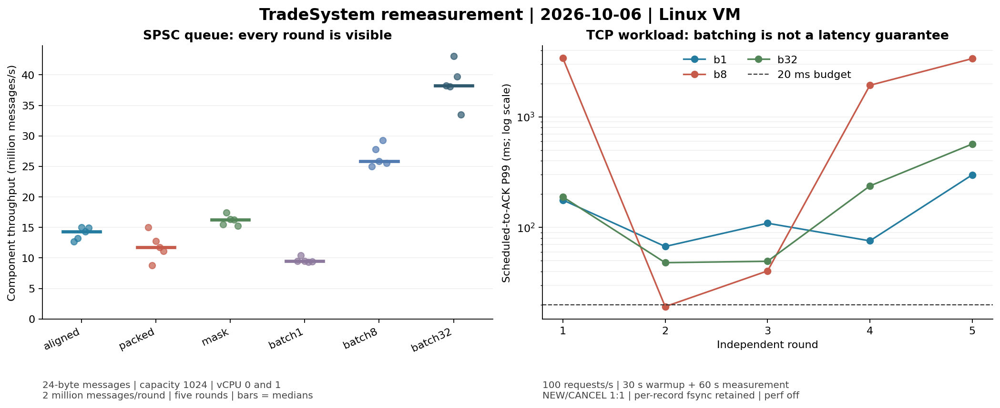

# 05 重新测量：perf、队列与批处理

测量日期：2026-10-06；文档整理：2026-10-07。基准提交：`f6bf805`，另含已归档的日志、快照及批处理实验改动。

本次使用 perf 查看 CPU 热点，分别测量队列和实际请求链路。**队列单独运行时有提速，接入业务后没有观察到稳定的 P99 改善。**保留逐条落盘审计时，50 请求/秒通过本次重复验收，100 请求/秒未通过。

## 这次补测什么

[02](../02_reproducible_measurement/02_reproducible_measurement.md)修正了测量口径，[03](../03_performance_tuning/03_performance_tuning.md)比较了诊断日志的开销。这次继续回答三个问题：

- CPU 时间主要花在哪里？用 perf 采样，并对照源码。
- 队列索引、内存布局和批量发布有没有收益？分别只改一个因素做对照。
- 队列变快后，业务请求是否更快？接入真实服务，检查延迟、积压和正确性。

实验候选没有替换默认实现，也没有减少关键审计的 write/fsync。

## 怎样测，数字代表什么

环境为 8 vCPU Linux 虚拟机，Release 构建，数据放 ext4。固定 4 个客户端、8 个品种，NEW/CANCEL 各半，不发生成交，通过本机 TCP 连接服务。关闭可选性能计时日志，普通日志及逐条 fsync 审计保留。

生成器按预定时刻发请求，不等上一条回报再发，这叫**开环负载**。这样服务一旦跟不上，积压会体现出来。正式性能轮次不同时运行 perf；采样另开诊断轮次。

| 指标 | 本文的含义 |
|---|---|
| 业务 P50 / P99 | 从计划发送到收到 ACCEPTED/CANCELED 回报，包含发送迟到、排队和服务处理；不是成交延迟 |
| 窗口完成速率 | 观察窗口内完成数 ÷ 窗口秒数；窗口结束后收到的回报不补算进去 |
| 请求队列高水位 | 服务内部请求队列曾经积压的最大条数，统计包含预热 |
| 窗口末在途 | 客户端到窗口结束还没有收齐回报的请求数，与内部队列深度不同 |

预先约定每轮同时满足：**业务对账正确、P99 ≤20 ms、窗口内完成比例 ≥98%、退出时队列排空**。P99 表示排序后约 99% 请求不超过的延迟，不能保证每一条都在 20 ms 内完成。

## perf 发现了什么

最初普通用户没有采样权限，将 `kernel.perf_event_paranoid` 临时从 4 调整到 1 后，软件事件可以使用。虚拟机仍不支持本次探测的 `cycles/instructions` 硬件事件，因此没有得到 IPC 或硬件 cache-miss 数据。

实际执行了 `perf stat` 计数、`perf record/report` 采样分析，并用 `perf annotate` 对照指令与源码。服务采到 **5,111 个样本，丢失样本为 0**。

采样较多的位置包括系统调用相关路径、读取时钟，以及 `MatchingEngine::run()`。撮合循环中的样本集中在运行标记、队列 head/tail 检查和循环回跳；源码也显示空队列时持续轮询。

这说明忙轮询和频繁读时钟值得继续检查。**CPU 热点还不能直接解释全部慢请求**：线程等待磁盘时并没有持续执行用户态代码，这段等待未必出现在用户态 CPU 热点中。本次没有宣称已经消除了这些热点或定位了全部 P99 毛刺。

<details>
<summary>查看 perf 命令与统计细节</summary>

以下命令附加到实验驱动启动的服务。诊断轮先预热 8 秒，再以 100 请求/秒观察 24 秒。

```bash
# 先分别检查软件事件、硬件事件是否可用。
perf stat -e task-clock,context-switches,cpu-migrations,page-faults -- sleep 0.2
perf stat -e cycles:u,instructions:u -- sleep 0.2

# 实验驱动并行启动这两个命令，结束时发送 SIGINT 停止采集。
perf stat -x ';' -e task-clock,context-switches,cpu-migrations,page-faults \
  -o perf_stat.txt -p "$SERVER_PID"
perf record -e cpu-clock:u -F 99 --call-graph fp -o perf.data -p "$SERVER_PID"

perf report --stdio --no-children --percent-limit 0.5 -i perf.data
perf report --stdio --children --percent-limit 1 -i perf.data
perf annotate --stdio --source --symbol='Exchange::MatchingEngine::run()' -i perf.data
```

软件计数：task-clock 82,705.87 ms、上下文切换 147,840 次、CPU 迁移 1,342 次、缺页 1,088 次。task-clock 是所有线程累计的 CPU 时间，可以超过观察窗口的墙钟时间。

Self 占比：`__syscall_cancel_arch_end` 约 26.37%，一个 vDSO 时钟路径约 24.54%，`MatchingEngine::run()` 约 21.91%。`system_clock::now()` 的 Children 约 39.89%；Children 包含子调用，不能与 Self 百分比直接相加。系统库符号和帧指针也会影响归因。

stat 覆盖用户态与内核态，record 此处只采用户态，不能相减得到精确的内核耗时。原始 perf 文件及文本报告保存在完整证据包；换机器解析需要匹配 build-id 的二进制。用法见 [perf record](https://man7.org/linux/man-pages/man1/perf-record.1.html) 与 [perf 权限说明](https://man7.org/linux/man-pages/man2/perf_event_open.2.html)。

</details>

## 队列单独测，有没有提速

一个线程生产、一个线程消费，分别固定到 vCPU 0/1。消息 24 字节、队列容量 1,024；每种配置做五轮，每轮先预热 10 万条，再正式传输 200 万条，逐条核对序号和内容。

| 配置 | 改了什么 | 吞吐中位数，百万条/秒 |
|---|---|---:|
| packed | head/tail 放在同一缓存行 | 11.7427 |
| aligned | 只把 head/tail 分隔到不同的 64 字节缓存行 | 14.3424 |
| mask | 在 aligned 基础上，只把槽位取模换成位掩码 | 16.2987 |
| batch1 | 使用批量接口，每次最多发布 1 条 | 9.5050 |
| batch8 | 同一批量接口，每次最多发布 8 条 | 25.8286 |
| batch32 | 同一批量接口，每次最多发布 32 条 | 38.2237 |

共 **6,000 万条正式传输全部正确**。这些改法分别针对索引访问时的缓存竞争、槽位计算，以及多条消息共享一次发布的开销。实验结果支持继续研究这些方向，但还要注意：

- 布局对照存在波动：packed 第一轮更快，后四轮更慢。没有硬件计数，不能把差异全部归因于伪共享。
- 位掩码要求容量为 2 的幂，实验版明确拒绝容量 0/3，不能直接替换所有原有队列。
- `batch1/8/32` 应互相比；`batch1` 与 `aligned` 使用不同接口，不能混作同一基线。

**这里每秒几千万条是队列传输能力。业务还要经过网络、排队、处理和逐条审计，不能把它写成交易系统吞吐。**

<details>
<summary>查看增幅算法与队列延迟口径</summary>

逐轮配对计算吞吐增幅，再取五轮中位数：packed→aligned 为 22.14%，aligned→mask 为 13.64%，batch1→batch8 为 170.39%，batch1→batch32 为 302.14%。它们是不同实验的结果，不能累加，也不是业务提速比例。

队列每 64 条抽一个时间样本，从首次尝试入队前计到消费取出，包含重试、组批与积压。吞吐计时也包含这项共同开销。aligned/packed/mask/batch1/batch8/batch32 的抽样 P99 中位数依次为 93.836 / 168.524 / 95.506 / 107.408 / 91.223 / 73.575 μs。

固定采样可能漏掉周期性毛刺，因此这些数值不是全量消息 P99。每轮先检查满、空、回绕；布局也按实际地址核对。本次未测完整的“布局 × 批量”组合。五轮原始数值见 [summary.json](summary.json) 的 `queue` 和 `queue_paired_percent`。

</details>

## 接入业务后，批处理有没有改善延迟

三个版本每批最多发布 1/8/32 条已到达请求，**不等待凑满一批**。整批放不下时逐条推进，剩余请求保留后续处理。三个版本使用同一实验实现，只改变批量上限。

每个版本测五轮：以 100 请求/秒预热 30 秒，再观察 60 秒。共 90,000 条正式请求，加预热共 135,000 条，15 轮业务对账全部通过。

| 批量上限 | P50，ms | P99，ms | 五轮 P99 范围，ms | 验收通过 |
|---:|---:|---:|---:|---:|
| 1 | 9.789 | 109.204 | 67.293–298.728 | 0/5 |
| 8 | 14.885 | 1,926.183 | 19.264–3,387.472 | 1/5 |
| 32 | 9.700 | 188.825 | 48.049–567.254 | 0/5 |

P50/P99 两列是**先算每轮分位数，再取五轮中位数**，不是把全部请求混在一起算出的分位数。原始轮次见 [summary.json](summary.json) 的 `network_paired`。

批量上限 8 有一轮结束时仍有 339 条请求未完成；后来全部收齐，也不能算作窗口内完成。上限设为 32 也不表示每次都有 32 条可发布，这组各轮实际平均批次约为 1.007–1.453 条。

**本次没有观察到批处理带来稳定的业务尾延迟优势。**这条链路保留了逐条 fsync，队列发布只是其中一段；减少发布开销不能保证减少整个请求的等待。各因素贡献还需要进一步对照，不能仅凭这次结果把所有慢请求归因于磁盘。

另外，控制组“每批 1 条”也使用实验批量接口，因此该表不是原始生产 FIFO 与候选实现的完整前后对比。[03](../03_performance_tuning/03_performance_tuning.md)的 96.28% 属于另一组日志策略实验，也不是本次批处理收益。



## 50 请求/秒通过，具体意味着什么

容量验证预先选定批量上限 1，不在测完后挑最快配置。先探索 10/25/50/100/200 请求/秒，再按既定规则，对探索通过的最高档 50/s 和下一档 100/s 分别重新测五轮。每轮预热 32 秒、观察 64 秒；50/s 全部通过后，再追加 304 秒观察。

| 档位 | 观察窗口 | P99，ms | 窗口完成速率，条/秒 | 验收通过 |
|---|---|---:|---:|---:|
| 50/s | 64 秒 × 5 轮 | 中位 15.649，范围 15.119–15.850 | 每轮 50.000 | 5/5 |
| 100/s | 64 秒 × 5 轮 | 中位 5,576.228，范围 3,496.733–10,777.519 | 83.000–94.391 | 0/5 |
| 50/s 追加观察 | 304 秒 × 1 轮 | 18.156 | 50.000 | 1/1 |

50/s 五轮各 3,200 条请求，全部在窗口内完成，内部请求队列高水位为 3–4。追加观察的 15,200 条请求也全部在窗口内完成，P50 为 10.838 ms，队列高水位为 12，但最慢一条达到 **296.556 ms**。所以“P99 通过”不等于“没有慢请求”。

100/s 五轮结束时分别还有 359/643/1,088/532/560 条请求在途。最后对账正确，性能验收仍然失败。

前面的 100/s 批处理实验与这里的 100/s 容量复测差异很大；探索阶段甚至出现 10/s 未通过、25/s 通过。这说明不同轮次的运行状态有波动，目前证据不足以确定是存储、宿主调度还是其他因素造成。两阶段不能混算，也不能据此画出精确的容量曲线。

**50/s 只是在本次环境和观察窗口内反复验证过的档位。50 与 100 之间没有继续细测，长期运行及生产条件也未验证。**

## 怎样核查与复现

三个 Release 业务版本各自通过 22/22 CTest；新增队列和 FIFO 批处理检查通过 ASan/UBSan，覆盖满/空、回绕、满载重试、部分发布与顺序。此次没有追加全项目 TSan。

全部 32 个网络轮次共核对 **161,760 条正式/观察请求，含预热 236,240 条**，业务核对均通过。各阶段的数据分别保存在 [summary.json](summary.json)，不合并成一个性能分布。

公开目录提供本报告、数值汇总及图表。完整复现还需要测量归档中的源码差异、脚本、原始 perf 和逐请求记录；只克隆此目录无法重跑全部实验。

<details>
<summary>查看版本、完整资料和复现步骤</summary>

- 基准提交：`f6bf805edcc64c0eedec810458977e84886c8d2b`。运行版本另含 `evidence/preexisting.patch` 和 FIFO 实验改动；以 `source_manifest.json`、`artifact_manifest.json` 中的源码与二进制身份为准，单看提交号不能还原运行版本。
- VMware 客体识别为 Intel i7-13650HX、8 vCPU。服务允许 vCPU 0–3，生成器固定 vCPU 4；不代表每个服务线程独占一个物理核。正式轮次不与编译、其他基准并发，宿主噪声仍存在。
- 编译：C++20、`-O3 -DNDEBUG -g -fno-omit-frame-pointer`，三个业务版本只改变 `TRADE_FIFO_BATCH=1/8/32`；`TRADE_PERF_TRACE_EVERY=0`，输入 seed 为 20260928。
- 队列检查包括容量 1/3/1024，掩码版为 1/2/1024 并拒绝 0/3；FIFO 另测容量 1/3/8/31、97 条请求、同时间戳稳定顺序和按时间排序。五轮结果不作为统计显著性证明。

完整证据包按原结构保留 `protocol.json`、`scripts/`、`queue_headers/`、`evidence/`、`network/`。其中 `queue_runs.json`、`network_paired.json` 保存详细轮次；`exchange_perf_*` 与 `perf_annotate_*` 保存采样分析；`network/*.tar.gz` 保存逐轮输入、请求 CSV、审计及结果。有采样的轮次另外保存 perf.data。普通日志保留在测量机器，文件清单记录归档范围和 SHA-256。

复现前准备 Linux、Python 3.12+、GCC/CMake、可用的软件 perf 事件及 vCPU 0–7，确认 12345 端口空闲。检查并按需临时调整 perf 权限，结束后恢复原配置。本次原值为 4。

```bash
# 改成当前机器上的仓库与完整证据包路径。
REPO=/path/to/TradeSystem
PACKAGE=/path/to/full-evidence-package

# 输出目录必须尚不存在，工具会另建源码副本。
python3 "$PACKAGE/scripts/reproduce.py" \
  --repo "$REPO" --output "$HOME/trade-measurements/perf-replay" --run
```

复现器依次还原冻结源码、构建并回归、执行实验、补充诊断、汇总数据。手动构建时须把输出保存为实验根目录的 `build.log`，供执行器检查完成标记。`--resume-after-profile` 仅用于已有完整前置记录的续跑，不是跳过检查的默认入口。

准备阶段曾补齐独立 FIFO 探针的头文件依赖，并修正执行器对 perf 被 SIGINT 正常停止的误判。原始失败记录保留在 `evidence/setup_attempt_1/`、`setup_attempt_2/`，不算作业务性能失败或生产源码修复。旧 record/02、03 及其慢轮、失败结论继续保留。

本次实验未提交候选源码；完整资料按原结构保留在测量机器及离线包中。上游来源与 MIT 许可见[根 README](../../README.md#来源与许可--attribution)。

</details>
